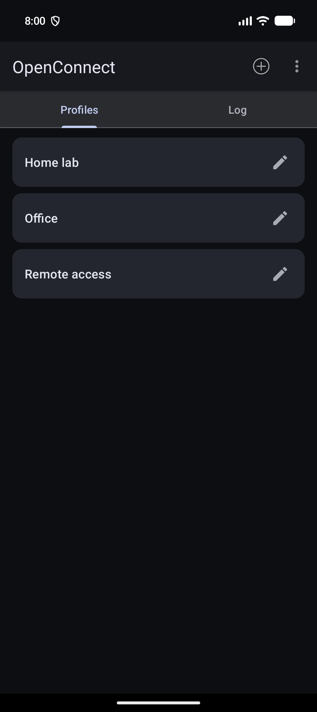
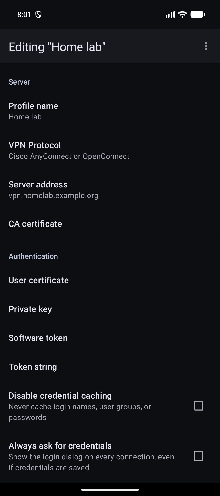
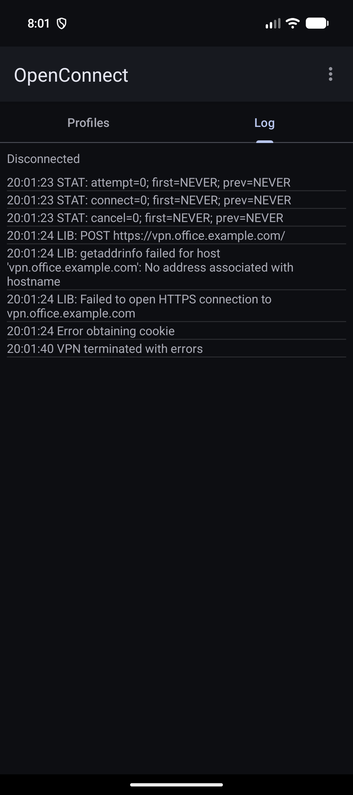
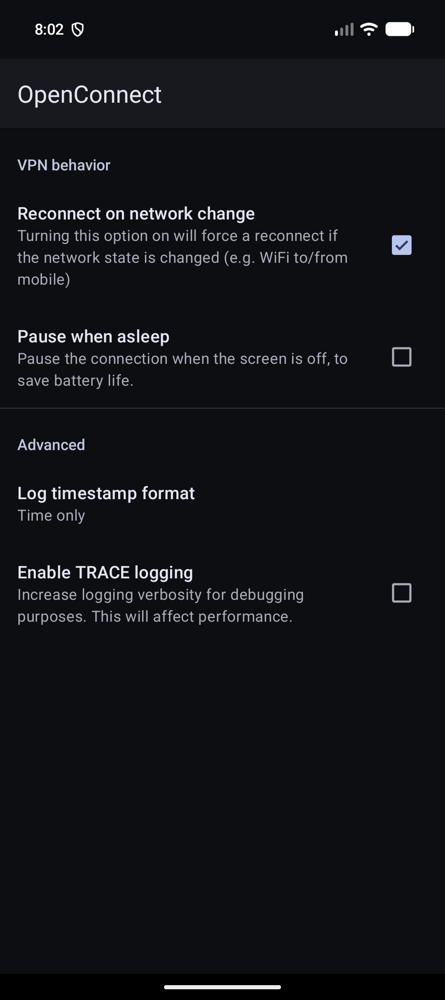
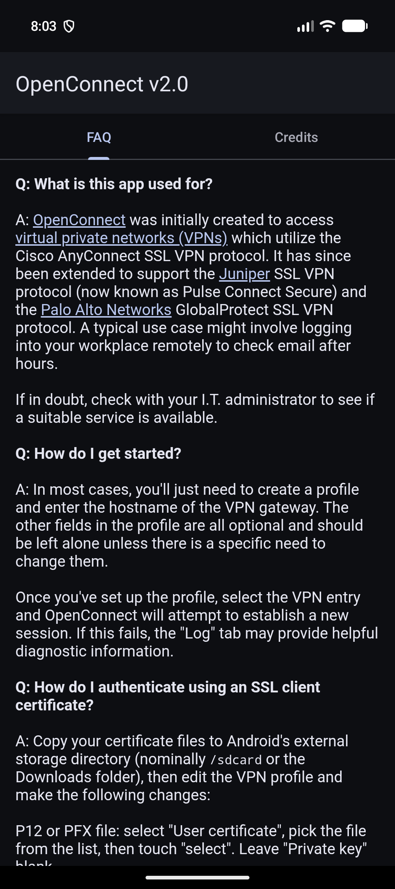
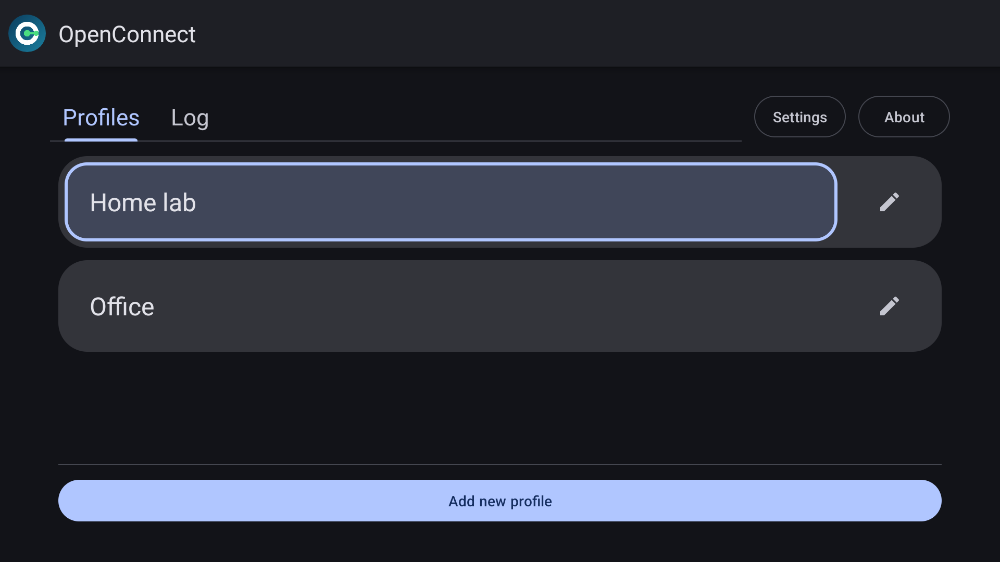
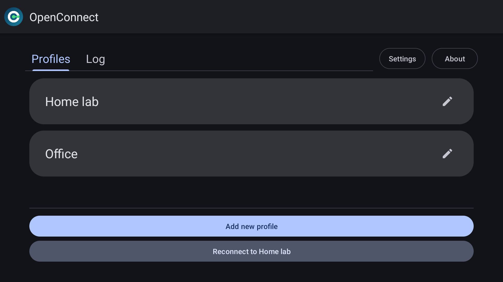
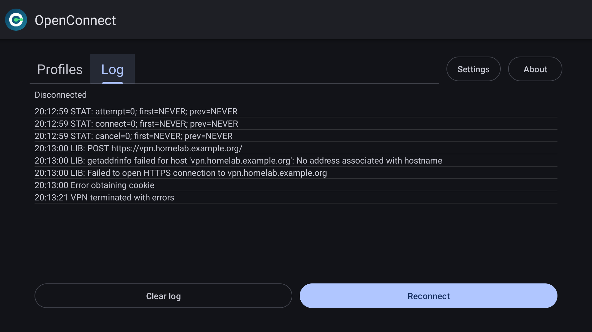
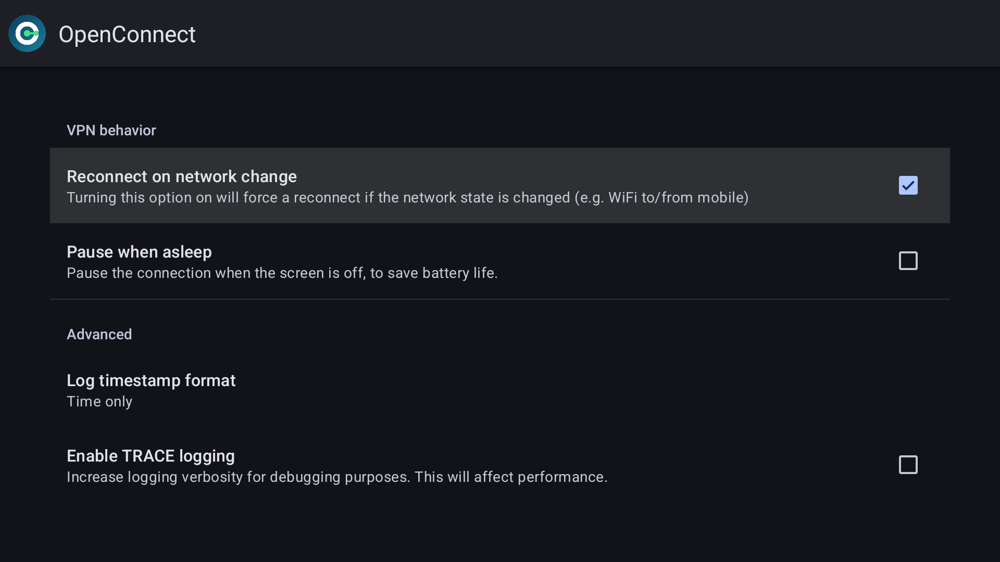

OpenConnect for Android
=======================

### NOTE

**There are no official openconnect packages in the Google Play Store.**
Get involved (see #1) to release the Android client.

---

Multi-protocol version, based on [openconnect](http://www.infradead.org/openconnect). [XDA thread](https://xdaforums.com/t/app-6-0-v1-12-openconnect-ssl-vpn-client-for-cisco-anyconnect.2616121/)

This is a VPN client for Android, based on the Linux build of
[OpenConnect](http://www.infradead.org/openconnect/).

Much of the Java code was derived from [OpenVPN for Android](https://play.google.com/store/apps/details?id=de.blinkt.openvpn&hl=en) by Arne Schwabe.

This repository is a fork of the
[ics-openconnect](https://gitlab.com/openconnect/ics-openconnect) project on GitLab
(kept as the `upstream` remote).  All original copyright and licence notices are kept, and
the changes are recorded in the git history.

### What this fork adds

* **Material 3 Expressive** look and feel, with dynamic colour and light/dark themes.
* A redesigned **Google TV / Android TV** interface: D-pad friendly profile cards, Settings,
  SecurID info and About in the header, and the Log, Reconnect and Disconnect actions as
  on-screen buttons, with sensible default focus.
* Profiles shown as cards, with a pencil icon to edit them.
* An **About** screen with FAQ and Credits tabs.
* Saved credentials are used without showing the login dialog; a new profile option,
  *Always ask for credentials*, brings the dialog back.
* Settings screens moved to AndroidX preferences.
* A new app icon and TV banner.
* Native libraries aligned for **16 KB page sizes**.
* Updated build toolchain: Gradle 9.8.1, Android Gradle Plugin 9.4.1, Java 25, compile SDK 37.

OpenConnect for Android is released under the GPLv2 license (GPLv2 or later, with an OpenSSL linking exception).  For more
information see the [COPYING](COPYING) and [doc/LICENSE.txt](misc/doc/LICENSE.txt)
files.

Changelog: see [doc/CHANGES.txt](misc/doc/CHANGES.txt)

## Downloads and support

Releases of this fork are published on the GitHub
[releases](https://github.com/antonioneves/openconnect/releases) page.  Report problems on the
[issue tracker](https://github.com/antonioneves/openconnect/issues).

The original project, which has its own releases, is at
[gitlab.com/openconnect/ics-openconnect](https://gitlab.com/openconnect/ics-openconnect).

## Screenshots

### Phone

||||||
|---|---|---|---|---|

### Google TV

| | |
|---|---|
|||
|||

## Building from source

### Prerequisites

On the host side you'll need to install:

* Android SDK in your $PATH (both platform-tools/ and tools/ directories)
* $ANDROID\_HOME pointed at the Android SDK directory
* JDK 25 and a recent version of Apache ant in your $PATH (Android Studio's bundled runtime
  works: point `JAVA_HOME` at it)
* Use the Android SDK Manager to install `"platform-tools" "build-tools;34.0.0" "platforms;android-37"`
* NDK r27c, nominally unzipped under /opt/android-sdk-linux\_x86/
* Host-side gcc, make, etc. (Red Hat "Development Tools" group or Debian build-essential)
* git, autoconf, automake, and libtool

If you encounter any issues, take a look at [`misc/Dockerfile`](https://gitlab.com/openconnect/ics-openconnect/-/blob/master/misc/Dockerfile).

### Compiling the external dependencies

Building OpenConnect from source requires compiling several .jar files and
native binaries from external packages.  These commands will build the binary
components and copy them into the appropriate library and asset directories:

```sh
git clone --recursive https://github.com/antonioneves/openconnect
cd openconnect
make -C external
```

This procedure only runs on a Linux PC.  On macOS, run it inside the Linux container described by
[`misc/Dockerfile`](misc/Dockerfile).  The native libraries are linked with
`-Wl,-z,max-page-size=16384` so they work on devices with 16 KB memory pages.  If you are unable to
build from source, you can try fetching the cached artifacts from a recent
[CI build of the upstream project](https://gitlab.com/openconnect/ics-openconnect/-/pipelines).


### Compiling the app

After the binary components are built, this compiles the Java sources into
an APK file:

```sh
./gradlew assembleDebug
```

To install the APK on a device:

    adb install -r app/build/outputs/apk/debug/app-debug.apk

### Release builds

`./gradlew assembleRelease` produces an unsigned APK unless `app/release.properties` exists.  To
sign it, create that file (it is ignored by git) with the path, alias and password of your own
keystore:

```
path=/path/to/your-release-key.jks
alias=your-key-alias
password=your-keystore-password
```

The signed APK is then written to `app/build/outputs/apk/release/app-release.apk`.  Keep the
keystore outside the repository and back it up: updates must be signed with the same key.

Logs of the upstream project's builds can be found on its
[CI page](https://gitlab.com/openconnect/ics-openconnect/-/pipelines).
